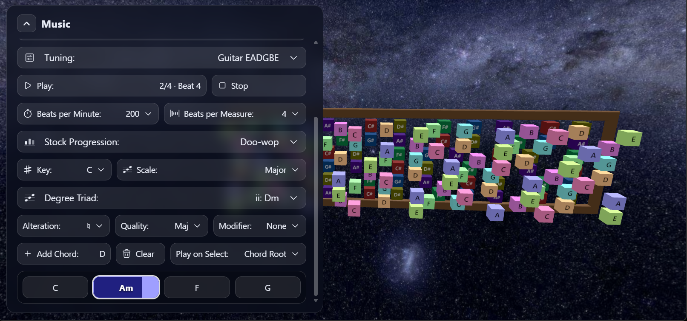

# XR Music

A fretboard of note cubes you play by touch in WebXR, or with the mouse on desktop. Built with [three.js](https://threejs.org), React, [@react-three/fiber](https://r3f.docs.pmnd.rs) and [@react-three/xr](https://pmndrs.github.io/xr/).



## Features

- **Fretboard**: one cube per string and fret, coloured by note. Scale notes stand out toward you; the current chord's notes stand out further.
- **Play**: touch cubes with controller tips, fingertips or a grabbable guitar pick. On desktop, hover (scale notes) or click and drag to strum (any note). Phones play by gaze.
- **Sound**: 13 sampled instruments, auto-tuned on load, plus four synth waves. Echo, quantize and velocity sensitivity.
- **Progressions**: 13 stock progressions or build your own from degree triads, alterations, qualities and 7th/6th/add9 modifiers. Drag to reorder, play/pause/stop, and optionally hear each chord as it lands.
- **XR**: grab, move, scale and rotate the board; bend notes by pulling along the frets; a hand-held menu panel you can dock to either controller or the board; haptics on every touch.
- **Views**: solid, skybox or passthrough backgrounds; side-by-side and interlaced 3D; phone AR and phone-viewer stereo.

Settings and the progression persist in a cookie.

## Keys

| Key | Action |
| --- | --- |
| `Space` / `P` | Play / pause progression |
| `Esc` | Stop |
| `I` / `Shift+I` | Next / previous instrument |
| `K`, `S`, `T`, `E` | Cycle key, scale, tuning, echo |
| `Enter` | Show / hide the panel |

## Develop

```sh
npm install
npm run dev        # http://localhost:5174, with a Quest 3 emulator
npm run dev:xr     # HTTPS on your LAN for a real headset
npm run build      # static site in dist/
```

Pushes to `master` deploy `dist/` to GitHub Pages.
